<p align="center">
  <picture>
    <source media="(prefers-color-scheme: dark)" srcset="assets/logo-dark-bg.svg">
    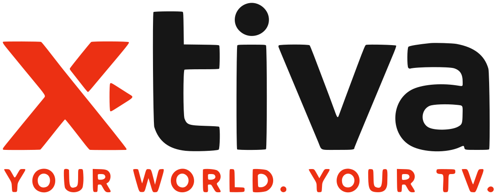
  </picture>
</p>

<h3 align="center">The player. Your world.</h3>

<p align="center">
  A free IPTV player for Android phones, tablets, Android TV, Google TV and Fire TV, also on iPhone, iPad, Mac and Apple TV.<br>
  Bring your own Xtream Codes or M3U playlist and watch with a TV guide, a movie and series library, and two playback engines.
</p>

<p align="center">
  <a href="https://play.google.com/store/apps/details?id=com.metawave.xtreamiptv"></a>
  &nbsp;
  <a href="https://apps.apple.com/app/id6809854986"></a>
</p>

<p align="center">
  <a href="https://github.com/hadiuzzaman524/xtiva-downloads/releases/latest"></a>
  <a href="https://github.com/hadiuzzaman524/xtiva-downloads/releases"></a>
  <a href="https://xtiva.app"></a>
</p>

<p align="center">
  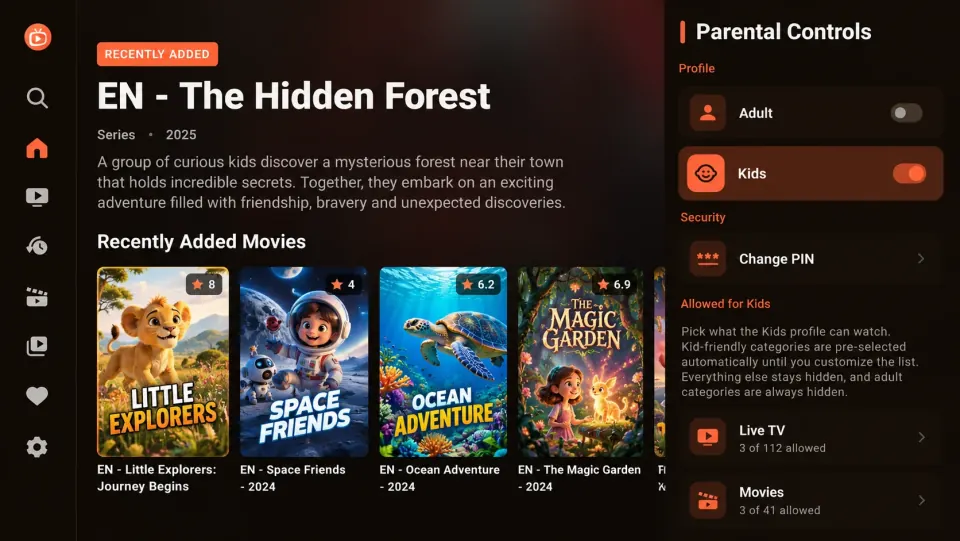
</p>

---

## Download

### 1. Official stores (recommended)

Install from the store whenever your device has one: updates arrive by themselves.

| Store | Devices |
| --- | --- |
| [**Google Play**](https://play.google.com/store/apps/details?id=com.metawave.xtreamiptv) | Android phones and tablets, Android TV, Google TV |
| [**App Store**](https://apps.apple.com/app/id6809854986) | iPhone, iPad, Mac (Apple silicon), Apple TV |

### 2. No Google Play? Fire TV and TV boxes: Downloader code

<p align="center">
  <a href="#install-on-a-tv"></a>
</p>

Copy the code (copy button on the right):

```
3989336
```

Open the **Downloader** app on your TV, type **`3989336`** and press **Go**. See [Install on a TV](#install-on-a-tv) for the full steps.

### 3. Direct APK links

For Android devices without Google Play. These links always point to the newest version.

| Device | Download | Size |
| --- | --- | --- |
| **Android TV, Google TV, Fire TV, TV boxes** | [**xtiva-tv.apk**](https://github.com/hadiuzzaman524/xtiva-downloads/releases/latest/download/xtiva-tv.apk) | ~58 MB |
| **Android phones and tablets** | [**xtiva-mobile.apk**](https://github.com/hadiuzzaman524/xtiva-downloads/releases/latest/download/xtiva-mobile.apk) | ~67 MB |
| Not sure, or neither installs | [xtiva.apk](https://github.com/hadiuzzaman524/xtiva-downloads/releases/latest/download/xtiva.apk) | ~243 MB |

The TV file also runs on most older phones. The large file works on every Android device; it is only bigger. Older versions are on the [Releases](https://github.com/hadiuzzaman524/xtiva-downloads/releases) page.

---

## What is Xtiva?

Xtiva is a player and nothing else. It ships **empty**: you connect the IPTV service you already subscribe to. No account is needed.

**Add your source your way**
- **Xtream Codes**: server address, username and password
- **M3U / M3U8** playlist link
- **Quick Play**: a direct stream URL
- **Restore a backup**: a `.xtiva` file exported from Xtiva on another device
- **Scan with your phone**: set up the TV by scanning its QR code with Xtiva on your phone, no typing with the remote

**Watch**
- **Live TV** with a programme guide (EPG), favourites and channel switching without leaving playback
- **Catch-up** for channels your provider archives
- **Movies and series** on genre shelves with posters, ratings and continue watching
- **Search** across your whole playlist
- **Two playback engines**, ExoPlayer and VLC: switch when a stream needs it
- **Several playlists** in one app, with a **Kids profile** and PIN

Free to download and use. Xtiva Pro is an optional in-app upgrade.

## Screenshots

**Android TV**

<p>
  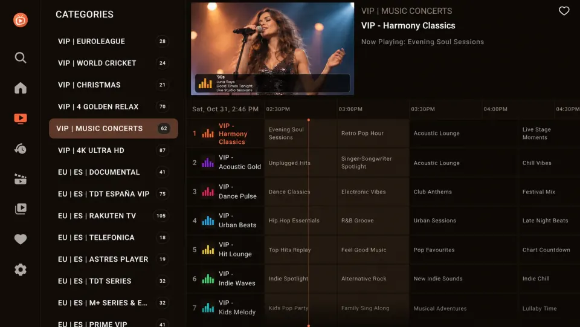
  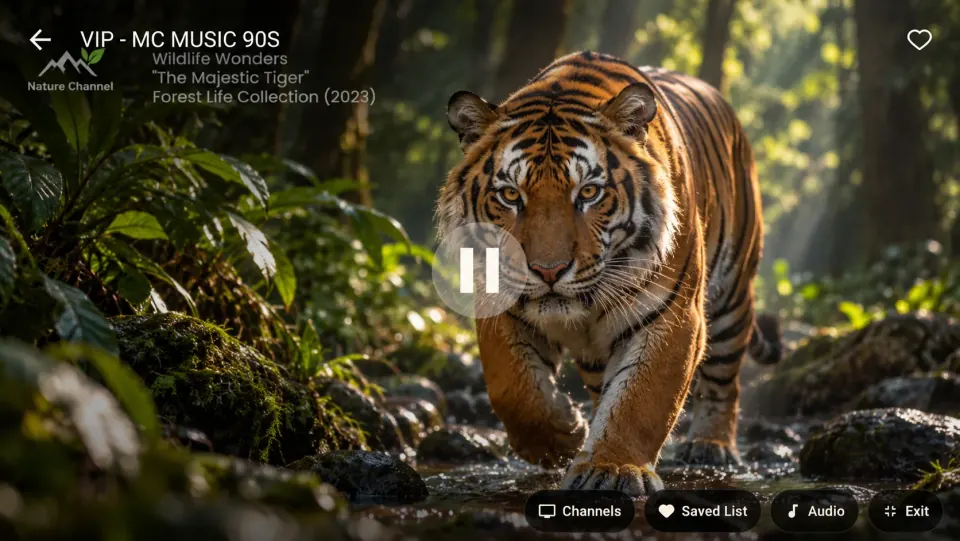
  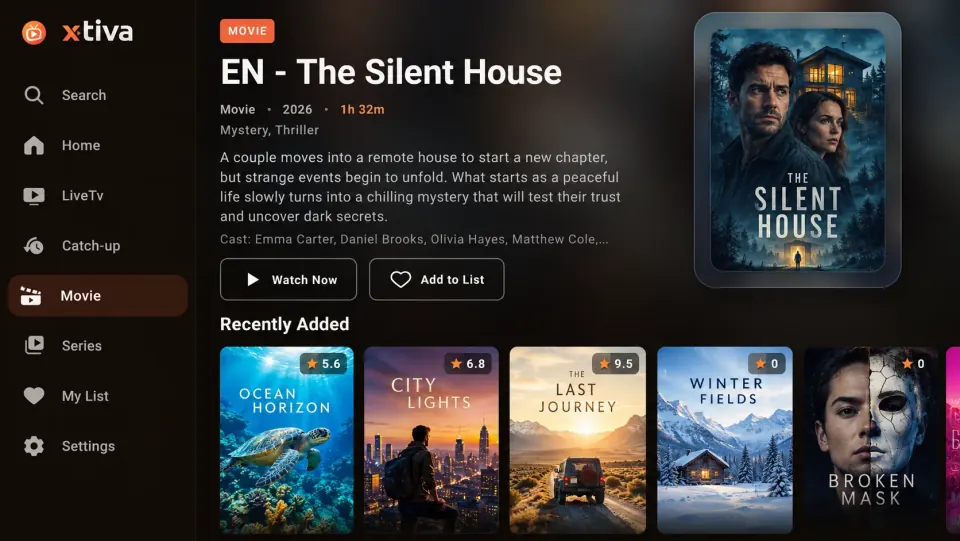
  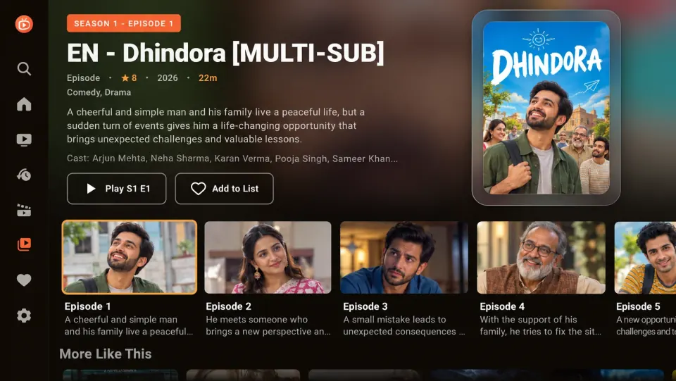
</p>

**Set up the TV from your phone**

<p>
  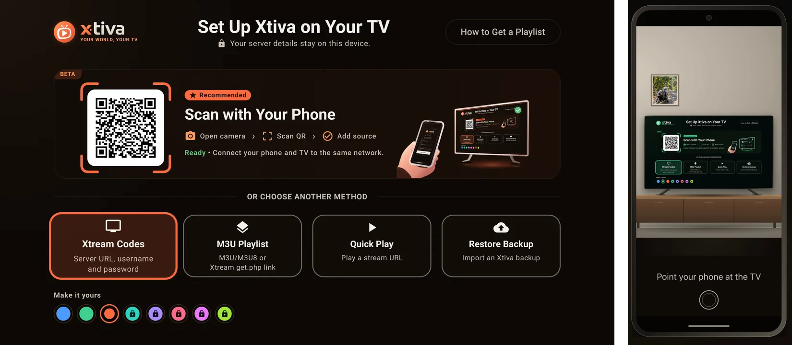
</p>

**Android phone**

<p>
  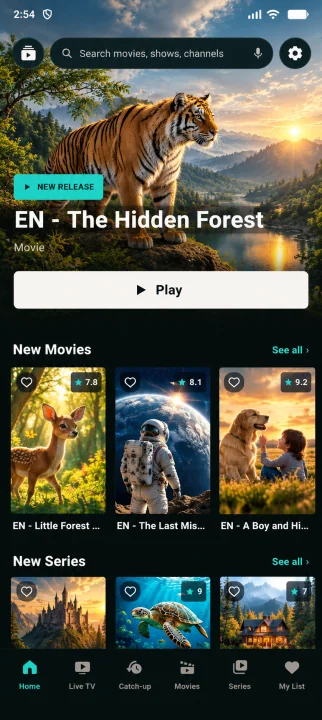
  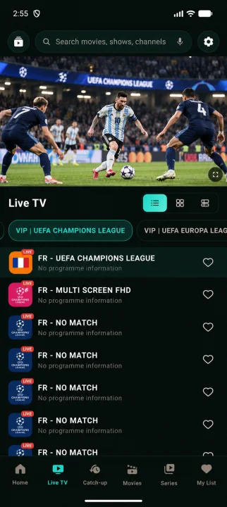
  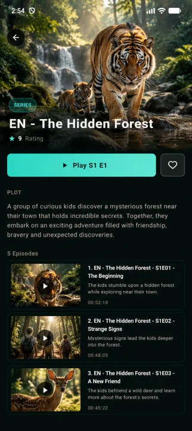
</p>

### Also on the App Store

> [!NOTE]
> Xtiva for iPhone, iPad, Mac and Apple TV comes from the [App Store](https://apps.apple.com/app/id6809854986) only. The APK files in this repository are for Android.

**Apple TV**

<p>
  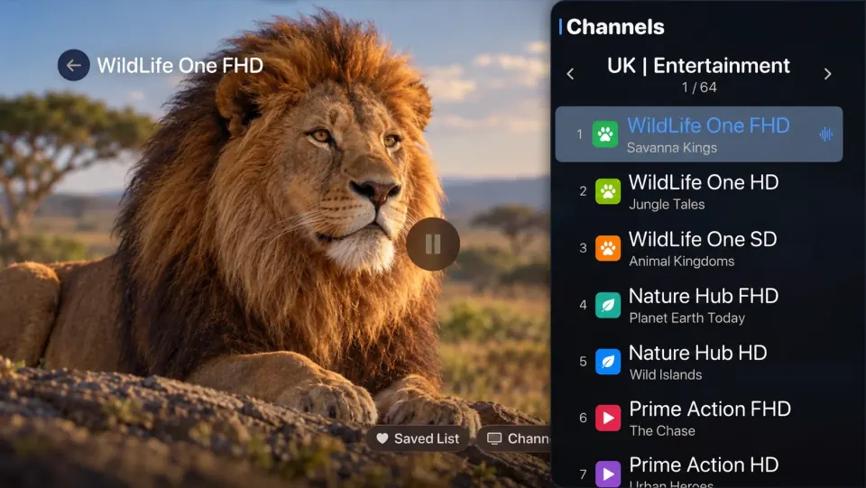
  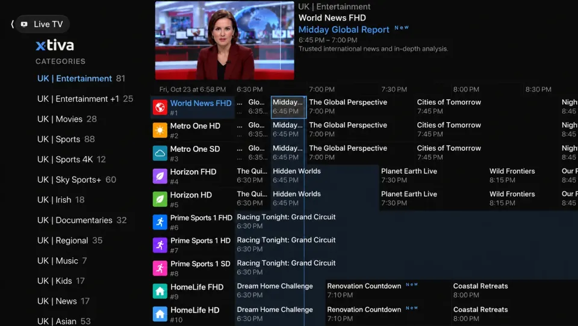
  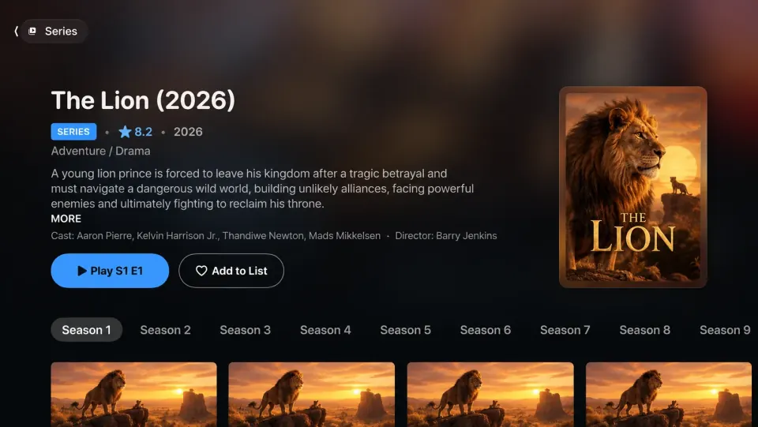
  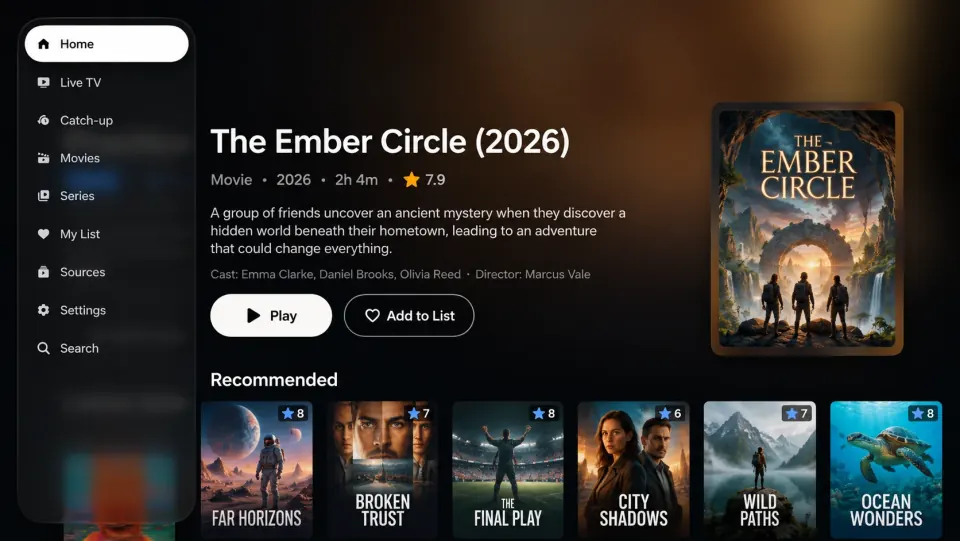
</p>

**iPhone**

<p>
  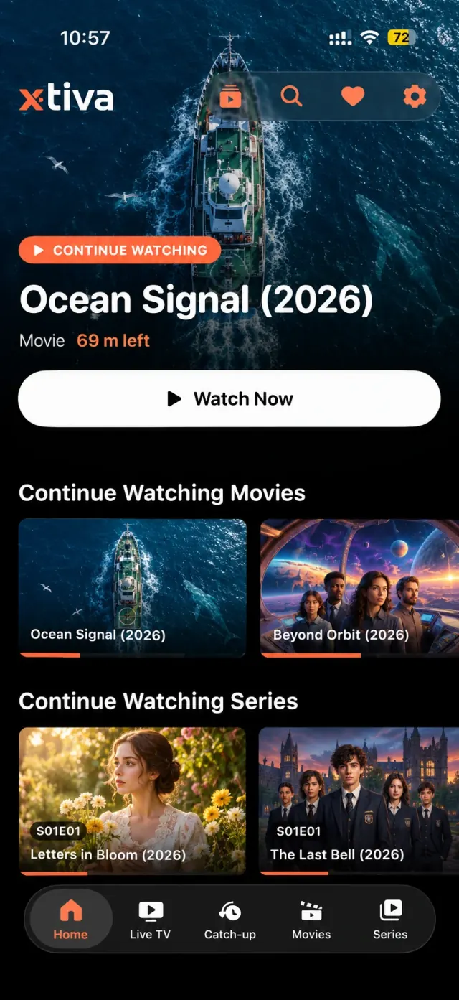
  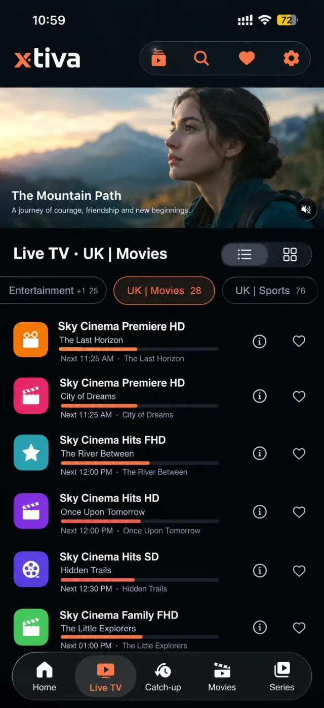
  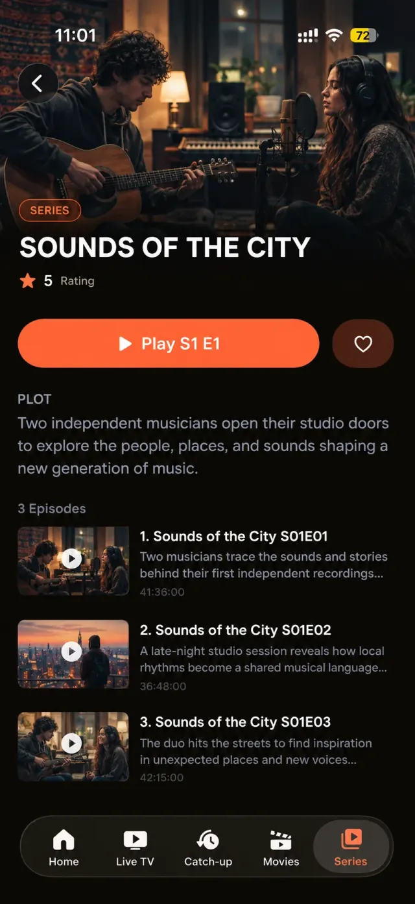
  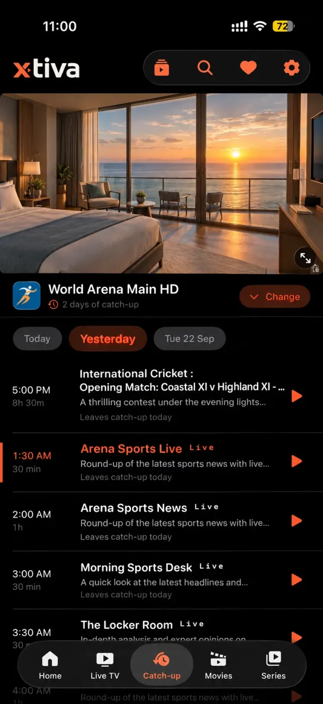
</p>

---

## Install on a TV

1. Install **Downloader** (by AFTVnews) from your TV's app store.
2. Let Downloader install apps:
   - **Fire TV:** Settings → My Fire TV → Developer options → Install unknown apps → Downloader → On. If Developer options is hidden, open Settings → My Fire TV → About and click the device name 7 times.
   - **Android TV / Google TV:** Settings → Apps → Security & restrictions → Unknown sources → Downloader → On (on some boxes: Settings → Device preferences → Security).
3. Open Downloader, enter **`3989336`** and press **Go**.
4. When the download finishes, choose **Install**, then **Open**.
5. Back in Downloader, choose **Delete** to free the space the file used.

## Install on a phone

1. Open the [phone download](https://github.com/hadiuzzaman524/xtiva-downloads/releases/latest/download/xtiva-mobile.apk) in your browser.
2. Open the downloaded file. If asked, allow your browser to install unknown apps.
3. Choose **Install**.

> [!NOTE]
> If Xtiva is already installed from Google Play, Android may refuse to install a downloaded file over it ("App not installed"). Keep updating from Google Play, or uninstall the Play version first. Uninstalling removes your sources and settings on that device.

## Before you press play

**Does Xtiva come with channels?** No. It is a player only. You need your own IPTV subscription (Xtream Codes details or an M3U link). We neither supply nor sell content.

**A channel will not play.** Switch the playback engine in Settings (ExoPlayer ⇄ VLC), check your connection, and check that the same stream works with your provider.

**How do I update?** Download again from the same link or Downloader code. They always point to the newest version, and installing over your current Xtiva keeps your sources.

---

## Join the community

Updates, tips and conversations.

<p>
  <a href="https://discord.gg/pZ7wDGQ8B3"></a>
  <a href="https://www.facebook.com/p/Xtiva-61594036323576/"></a>
  <a href="https://www.instagram.com/xtiva.app/"></a>
  <a href="https://x.com/xtivaapp"></a>
  <a href="https://www.youtube.com/channel/UCNgS0kk5SkhdkcisSd9FOvA"></a>
  <a href="https://www.linkedin.com/company/xtiva"></a>
</p>

<p align="center">
  <br>
  <a href="https://xtiva.app">xtiva.app</a> · <a href="https://xtiva.app/privacy-policy.html">Privacy</a> · <a href="https://xtiva.app/terms.html">Terms</a> · <a href="LICENSE">License</a><br>
  <sub>© 2026 Axovate Labs. All rights reserved.</sub><br>
  <sub>Xtiva is a player. No channels, playlists or media are included.</sub>
</p>
